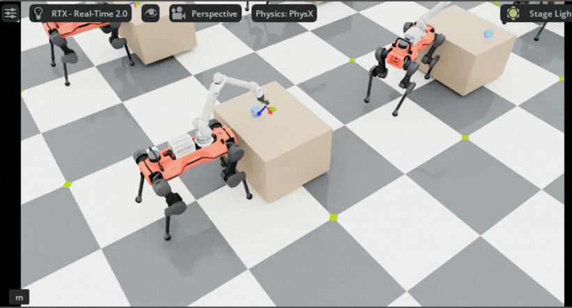
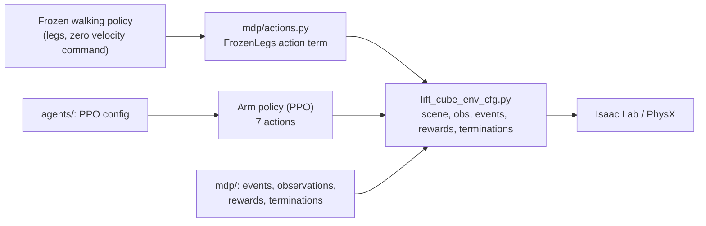
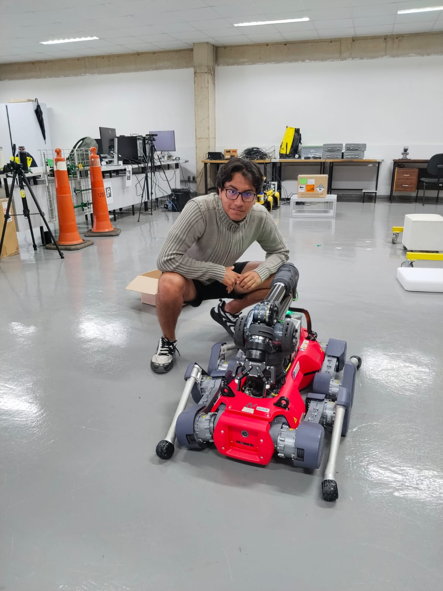

# Cube lifting with a legged manipulator (ANYmal D + DynaArm + Robotiq 2F-85)

**Problem.** Grasp a cube from a table and lift it with the DynaArm and gripper while the ANYmal D stands on its own legs. A frozen walking policy holds the legs; the policy being trained controls only the arm and gripper.

Isaac Lab 3.0 / Isaac Sim 6.1, PhysX. PPO (RSL-RL), 256 parallel environments, 1500 iterations, 50 Hz control.

## MDP

| | Details |
|---|---|
| Observations (24) | arm and gripper joint positions (7), joint velocities (7), cube position in the robot base frame (3), last action (7) |
| Actions (7) | 6 arm joint position targets + binary gripper (open / closed) |
| Rewards | reaching: gripper-to-cube distance (+1.0); lifted and held: cube more than 4 cm above the table and within 12 cm of the gripper (+15); action rate (-1e-4); joint velocity (-1e-4); robot fell (-20) |
| Terminations | time out (5 s), cube dropped off the table, bad base orientation, base too low |
| Domain randomization | body pose in front of the table (+-5 cm, +-5 deg), table height (+-3 cm), cube position (+-15 cm), initial arm pose (+-0.1 rad), foot friction |

## Architecture

## The robot

*Me with the ANYmal D at the USP Center for Robotics (CROB).*

## Results

- Lift reward term rose from 0.09 to 2.96 over 1500 iterations (training log, weighted, maximum 15).
- Video: arm grasping and lifting the cube.

> *Code is confidential (USP Center for Robotics - CROB) and cannot be shared. Available upon request with lab approval.*
